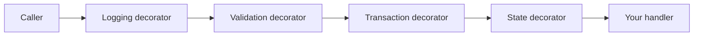
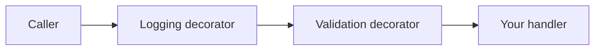

# Architecture

How the request pipeline is built, the order of its decorators, and the design principles behind it.

## Pipeline flow

Each handler is wrapped in decorators. Each decorator does one task and calls the next; the last one calls your handler.

### Command pipeline

| Step | Decorator | Applies to | Task |
| --- | --- | --- | --- |
| 1 | `CommandLoggingDecorator` | All commands | Logs the start and the outcome. Converts exceptions to `InternalError` and cancellations to `Canceled`. |
| 2 | `CommandValidationDecorator` | Commands with an `IValidator<T>` | Runs the validators. Returns `Invalid` if there are errors. |
| 3 | `TransactedStateCommandDecorator` | `ITransactedStateCommand` | Runs the handler and the save in a transaction, commits, then runs the post-commit hooks. |
| 4 | `StateCommandDecorator` | `IStateCommand` | Calls `SaveChangesAsync` after a successful handler, then runs the post-commit hooks, or defers them to the outermost commit if a pipeline transaction is open. |
| 5 | Handler | All commands | Runs the domain logic and returns an `IResult`. |

The state and transaction decorators wrap only state command handlers, so a plain `ICommand` passes through logging and validation only and needs no `IStateUnit` or `ITransactionUnit`. Each state command gets both persistence decorators; each one checks the command type at run time and simply calls the next step if it does not apply.

### Query pipeline

| Step | Decorator | Task |
| --- | --- | --- |
| 1 | `QueryLoggingDecorator` | Logs the start and the outcome. Converts exceptions and cancellations to results. |
| 2 | `QueryValidationDecorator` | Runs the validators. Returns `Invalid<T>` if there are errors. |
| 3 | Handler | Reads the data and returns an `IResult<T>`. |

Queries have no persistence decorators, so a query cannot save data through the pipeline.

## How AddCqrsHandlers builds the pipeline

`AddCqrsHandlers` scans the assemblies, registers the validators, handlers, and post-commit hooks as scoped services, and then wraps each handler registration from the inside out:

| Order | Decorator | Position |
| --- | --- | --- |
| 1 | State | Innermost, next to the handler |
| 2 | Transaction | Around the state decorator |
| 3 | Validation | Around the transaction decorator |
| 4 | Logging | Outermost, next to the caller |

Each step replaces the registration with a factory that builds the new decorator around the previous service. The factories are compiled at startup with `ActivatorUtilities.CreateFactory`, so resolving a handler uses no reflection.

Each call to `AddCqrsHandlers` wraps only the handlers that it registers, so you can call it once per module. A validator or hook found by two calls is registered once. A handler you register yourself, outside `AddCqrsHandlers`, does not get the pipeline.

At startup, `AddCqrsHandlers` also throws `InvalidOperationException` if a type implements both `IQuery<T>` and a state command marker, if a post-commit hook targets a command that is not a state command, or if a hook has no handler with a matching signature (see [Hook interfaces](POST-COMMIT-HOOKS.md#hook-interfaces)).

### Why the order matters

- **Logging is outermost**, so it records every request, including those that fail validation, and catches every exception from the inner steps.
- **Validation is before persistence**, so invalid input never opens a transaction or touches the database. See [Validators](COMMANDS-AND-QUERIES.md#validators).
- **The transaction is outside the state decorator**, so saves from child commands happen inside the open transaction.
- **The state decorator is next to the handler**, so it saves only after the handler succeeds.

## Exception and cancellation handling

The pipeline never throws to the caller. The innermost decorator that catches an exception logs it and converts it to a result:

| Where it happens | Exception | Result | Log event |
| --- | --- | --- | --- |
| Before the handler starts | Caller's token already canceled | `Canceled` | `RequestCanceledPreExecution` (1003) |
| A validator, or the handler of a non-transacted request | `OperationCanceledException`, caller's token canceled | `Canceled` | `RequestCanceledMidExecution` (1005) |
| A validator, or the handler of a non-transacted request | Any other exception | `InternalError` | `RequestFaulted` (1006) |
| `SaveChangesAsync` of an `IStateCommand` | `OperationCanceledException`, caller's token canceled | `Canceled` | `SaveChangesCanceled` (2001) |
| `SaveChangesAsync` of an `IStateCommand` | Any other exception | `InternalError` | `SaveChangesFaulted` (2002) |
| Handler, save, or commit of an `ITransactedStateCommand` | `OperationCanceledException`, caller's token canceled | `Canceled` | `TransactionCanceled` (4001) |
| Handler, save, or commit of an `ITransactedStateCommand` | Any other exception | `InternalError` | `TransactionFaulted` (4002) |
| Post-commit hook | `OperationCanceledException` | Unchanged | `PostCommitHookCanceledMidExecution` (3001) |
| Post-commit hook | Any other exception | Unchanged | `PostCommitFaulted` (3002) |

An `OperationCanceledException` becomes `Canceled` only if the caller's token is canceled. Otherwise, for example after an `HttpClient` timeout, it is an unexpected fault and becomes `InternalError`.

## Log events

Every log entry uses an event ID from `CqrsLogEvent` and the request type as its category.

| ID | Event | Level | Meaning |
| --- | --- | --- | --- |
| 1001 | `RequestStarted` | Information | The request entered the pipeline. |
| 1002 | `RequestSucceeded` | Information | The request returned a success result. |
| 1003 | `RequestCanceledPreExecution` | Warning | The token was canceled before the request started. |
| 1004 | `RequestFailed` | Warning | The request returned a failure result. The message includes the result. |
| 1005 | `RequestCanceledMidExecution` | Warning | The request was canceled while running. |
| 1006 | `RequestFaulted` | Error | The request threw an exception. |
| 1007 | `RequestValidationFailed` | Warning | A validator reported errors. The message includes the `ValidationState`. |
| 2001 | `SaveChangesCanceled` | Warning | The save was canceled. |
| 2002 | `SaveChangesFaulted` | Error | The save threw an exception. |
| 3001 | `PostCommitHookCanceledMidExecution` | Warning | A hook threw `OperationCanceledException`. |
| 3002 | `PostCommitFaulted` | Error | A hook threw an exception. Monitor this event for lost side effects. |
| 3003 | `PostCommitHookInUnmanagedTransaction` | Warning | Hooks ran inside a transaction that the pipeline did not start. |
| 4001 | `TransactionCanceled` | Warning | The transaction was canceled. |
| 4002 | `TransactionFaulted` | Error | The transaction threw an exception. |

Because the logging decorator is outermost, a failure from an inner decorator is logged twice: once by the inner decorator (for example 2002) and once as `RequestFailed` (1004).

## Scopes and service lifetimes

Every service the pipeline uses is scoped: handlers and their decorators, validators, post-commit hooks, `IStateUnit` and `ITransactionUnit` (which you register, normally with `AddEntityFrameworkUnits<TDbContext>()`), and the internal `PostCommitScope` that holds the deferred hooks of child commands.

They must come from one service scope, so that they share one `DbContext`, one transaction, and one list of deferred hooks. EF Core already requires this, because a child command joins the outer transaction only if it uses the same `DbContext`, so the pipeline adds no new constraint. In practice:

| Expectation | What happens otherwise |
| --- | --- |
| Each unit of work, such as an HTTP request or a message, has its own service scope. | Handlers resolved from the root provider share one scope across all requests, so one request's hooks can follow another's transaction. EF Core also does not support the shared `DbContext`. |
| Child commands in one scope run one after another. | `PostCommitScope` is not thread-safe, and EF Core does not allow parallel work on one `DbContext`. |
| Interleaved operations, for example in a Blazor Server circuit, each have their own scope or `DbContext`. | One operation's hooks can wait for another operation's transaction. |
| Transactions start through `ITransactedStateCommand`. | Hooks can run before the real commit. See [Transactions the pipeline did not start](POST-COMMIT-HOOKS.md#transactions-the-pipeline-did-not-start). |

Sending a child command in a separate scope is not an error. Its `DbContext` is outside the outer transaction, so its save commits and its hooks run immediately, which matches the data.

## Design principles

1. **Handlers contain domain logic only.** The pipeline logs, validates, saves, and manages transactions.
2. **The marker interface sets the behavior.** The request type, not the handler, tells the pipeline what to do.
3. **Results, not exceptions.** Handlers return results for expected outcomes. Exceptions are for unexpected faults.
4. **Queries are read-only.** Enforced at startup.
5. **Side effects happen after the commit.** External calls go in [post-commit hooks](POST-COMMIT-HOOKS.md), which do not run if the save fails.
6. **One transaction per request.** Only the outermost `ITransactedStateCommand` opens a transaction; child commands join it.
