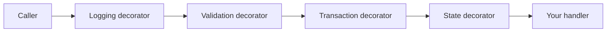
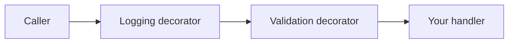

# Architecture

This document describes the request pipeline in DannyGoodacre.Cqrs.
It shows the order of the decorators and the design rules of the library.

## Pipeline flow

Each handler is wrapped in decorators. Each decorator does one task and then calls the next decorator.
The last decorator calls your handler.

### Command pipeline

| Step | Decorator                         | Applies to | Task |
| --- |-----------------------------------| --- | --- |
| 1 | `CommandLoggingDecorator`         | All commands | Logs the start and the outcome. Converts exceptions to `InternalError` and cancellations to `Canceled`. |
| 2 | `CommandValidationDecorator`      | Commands with an `IValidator<T>` | Runs the validator. Returns `Invalid` if there are errors. |
| 3 | `TransactedStateCommandDecorator` | `ITransactedStateCommand` | Opens a transaction, runs the handler, saves, and commits. Runs the post-commit hooks after the commit. |
| 4 | `StateCommandDecorator`           | `IStateCommand` | Calls `SaveChangesAsync` after a successful handler. Runs the post-commit hooks after the save, or after the outermost commit if a transaction is open. |
| 5 | Handler                           | All commands | Runs the domain logic. Returns an `IResult`. |

All decorators wrap all command handlers. Each decorator checks the command type at run time.
If the decorator does not apply to the command, it calls the next step and does nothing else.

### Query pipeline

| Step | Decorator | Task |
| --- | --- | --- |
| 1 | `QueryLoggingDecorator` | Logs the start and the outcome. Converts exceptions and cancellations to results. |
| 2 | `QueryValidationDecorator` | Runs the validator. Returns `Invalid<T>` if there are errors. |
| 3 | Handler | Reads the data. Returns an `IResult<T>`. |

Queries have no persistence decorators. A query cannot save data through the pipeline.

## Decorator wrapping order

`AddCqrsHandlers` builds the pipeline in these steps:

1. It scans the assemblies for handlers, validators, and post-commit hooks.
2. It registers each handler as a scoped service.
3. It wraps each handler registration in a decorator. It starts with the innermost decorator.
4. It registers the validators and the post-commit hooks.

The innermost decorator is registered first. The outermost decorator is registered last.
Each registration replaces the previous one with a factory. The factory creates the new decorator around the previous service.

| Registration order | Decorator | Position |
| --- | --- | --- |
| 1 | State decorator | Innermost. Next to the handler. |
| 2 | Transaction decorator | Around the state decorator. |
| 3 | Validation decorator | Around the transaction decorator. |
| 4 | Logging decorator | Outermost. Next to the caller. |

The factories are compiled at startup with `ActivatorUtilities.CreateFactory`.
The container does not use reflection when it resolves a handler for a request.

Each call to `AddCqrsHandlers` wraps only the handlers that the call registers. You can call it more than one time, for example one time for each module.
A validator or hook that two calls find is registered one time only.
A handler that you register yourself, outside `AddCqrsHandlers`, does not get the pipeline.

### Why the order is important

- **Logging is outermost.** It records each request, also requests that fail validation. It catches all exceptions from the inner steps.
- **Validation is before persistence.** Invalid input does not open a transaction or touch the database.
- **The transaction is outside the state decorator.** All saves from child commands occur inside the open transaction.
- **The state decorator is next to the handler.** It saves only the changes that the handler made.

## Validation short-circuit

The validation decorator runs before the transaction decorator, the state decorator, and the handler.

The decorator does these steps:

1. It gets all `IValidator<T>` services for the request from the container. If there are none, it calls the next step.
2. It creates a new, empty `ValidationState`.
3. It calls `Validate(request, validationState)` on each validator. The validators add errors with `AddError`.
4. It reads `validationState.HasErrors`.
5. If `HasErrors` is `false`, it calls the next step.
6. If `HasErrors` is `true`, it logs event `RequestValidationFailed` (1007). Then it returns `Invalid` or `Invalid<T>` with the `ValidationState`.

In step 6, the decorator does not call the next step. Thus:

- No transaction starts.
- `SaveChangesAsync` does not run.
- The handler does not run.
- The post-commit hook does not run.

The logging decorator then receives the `Invalid` result. It logs `RequestFailed` (1004).

The example tests prove this with an EF Core interceptor. An invalid request sends no SQL command and starts no transaction.
See `HandleAsync_WhenValidationFails_ShortCircuitsBeforeTheTransaction` in [TESTING.md](TESTING.md#other-transacted-tests).

`IValidator<T>.Validate` is synchronous. Use validators for input rules only, for example required fields and value ranges.
Put rules that need the database in the handler. Return `Conflict` or `DomainError` from the handler for these rules.

## Exception and cancellation handling

The pipeline does not throw exceptions to the caller. The decorators convert exceptions to results.
An `OperationCanceledException` becomes `Canceled` only if the caller's token is canceled.
Otherwise, for example after an `HttpClient` timeout, it is an unexpected fault and becomes `InternalError`.

## Service lifetimes

| Service | Lifetime |
| --- | --- |
| Handlers and their decorators | Scoped |
| Validators | Scoped |
| Post-commit hooks | Scoped |
| `IStateUnit` and `ITransactionUnit` | Scoped. You register these. |
| `PostCommitScope` (internal) | Scoped. `AddCqrsHandlers` registers it. It holds the deferred hooks of child commands. |

The handler, the state unit, the transaction unit, and the post-commit scope must share one scope.
Then they share one `DbContext`, one transaction, and one list of deferred hooks.
Use one service scope for each unit of work. [TRADEOFFS.md](TRADEOFFS.md#the-pipeline-depends-on-one-scope-for-each-unit-of-work) lists the rules and what goes wrong if you break them.

## Design principles

1. **Handlers contain domain logic only.** Handlers do not log, validate input, save, or open transactions. The pipeline does these tasks.
2. **The marker interface sets the behavior.** The request type tells the pipeline what to do. The handler does not tell the pipeline.
3. **Results, not exceptions.** Handlers return `IResult` values for all expected outcomes. Exceptions are only for unexpected faults.
4. **Queries are read-only.** `AddCqrsHandlers` stops at startup if a query also has a state command marker.
5. **Side effects occur after the save.** External calls, such as emails, go in post-commit hooks. They do not run if the save fails. See [POST-COMMIT-HOOKS.md](POST-COMMIT-HOOKS.md).
6. **One transaction for each request.** A transaction opens only at the outermost `ITransactedStateCommand`. Child commands use the same transaction.

## Related documents

- [COMMANDS-AND-QUERIES.md](COMMANDS-AND-QUERIES.md)
- [POST-COMMIT-HOOKS.md](POST-COMMIT-HOOKS.md)
- [TRADEOFFS.md](TRADEOFFS.md)
- [PERSISTENCE.md](PERSISTENCE.md)
- [RESULT-HANDLING.md](RESULT-HANDLING.md)
- [TESTING.md](TESTING.md)
