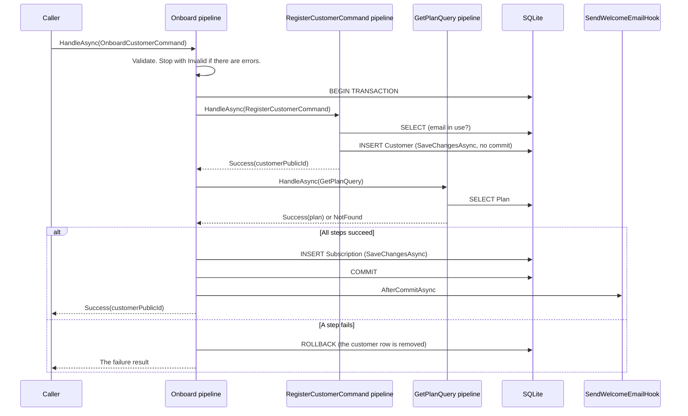

# Examples

The example project is a customer onboarding workflow that uses DannyGoodacre.Cqrs with EF Core and an in-memory SQLite database. Its test project sends each request through the full pipeline to that database. The other documents quote this project and name the source file of each quote.

| Project | Path |
| --- | --- |
| Console application | [`src/DannyGoodacre.Cqrs.Examples`](../../DannyGoodacre.Cqrs.Examples) |
| Pipeline tests | [`tests/DannyGoodacre.Cqrs.Examples.Tests`](../../../tests/DannyGoodacre.Cqrs.Examples.Tests) |

## Run the examples

From the repository root:

```shell
dotnet run --project src/DannyGoodacre.Cqrs.Examples
dotnet run --project tests/DannyGoodacre.Cqrs.Examples.Tests
```

The console application prints one line for each result (the identifiers change on every run):

```text
Registered customer 74196979-a113-4570-9f35-bcd1deadffeb.
Onboarded customer 634f83e5-67c7-4b5a-90a8-719e3db4129b on plan PREMIUM.
Conflict: A customer with this email address already exists.
Plan 'GOLD' does not exist. No data was saved.
The request is not valid:
Name:
  - Name is required.
Email:
  - Email format is invalid.
PlanCode:
  - Plan code is required.
Customer 74196979-a113-4570-9f35-bcd1deadffeb is on plan (none).
Customer 634f83e5-67c7-4b5a-90a8-719e3db4129b is on plan PREMIUM.
Customer 04ae8d97-1eb3-4861-97ea-f5e65a460875 does not exist.
Customers: Ann Lee, Jane Doe.
Plans: BASIC, PREMIUM.
The request is not valid:
Page:
  - Page must be at least 1.
Customers named 'Jane': Jane Doe.
The request is not valid:
Page:
  - Search results stop after page 5.
```

The pipeline logs are interleaved with these lines. For example, the conflict produces:

```text
info: DannyGoodacre.Cqrs.Examples.Onboarding.OnboardCustomerCommand[1001] 'OnboardCustomerCommand' started
info: DannyGoodacre.Cqrs.Examples.Customers.RegisterCustomerCommand[1001] 'RegisterCustomerCommand' started
warn: DannyGoodacre.Cqrs.Examples.Customers.RegisterCustomerCommand[1004] 'RegisterCustomerCommand' failed: Conflict { Message = A customer with this email address already exists. }
warn: DannyGoodacre.Cqrs.Examples.Onboarding.OnboardCustomerCommand[1004] 'OnboardCustomerCommand' failed: Conflict { Message = A customer with this email address already exists. }
```

## Domain

| Entity | Description |
| --- | --- |
| `Customer` | A registered customer with a unique email address. |
| `Plan` | A subscription plan, keyed by its code. The database is seeded with `BASIC` and `PREMIUM`. |
| `Subscription` | Links one customer to one plan. |

## Requests

| Request | Marker | Result | Shows |
| --- | --- | --- | --- |
| `RegisterCustomerCommand` | `IStateCommand` | `IResult<Guid>` | Automatic save, a validator, and a `Conflict` result. |
| `GetCustomerQuery` | `IQuery<CustomerDetails>` | `IResult<CustomerDetails>` | A query and a `NotFound` result. |
| `GetPlanQuery` | `IQuery<PlanDetails>` | `IResult<PlanDetails>` | A query called by a transacted command. |
| `OnboardCustomerCommand` | `ITransactedStateCommand` | `IResult<Guid>` | One transaction around a child command and a child query, a rollback, `MapFailure`, and a post-commit hook. |
| `ListQuery<CustomerDetails>`, `ListQuery<PlanDetails>` | `IQuery<IReadOnlyList<TItem>>`, `IPagedRequest` | `IResult<IReadOnlyList<TItem>>` | A generic request, handled by closed handlers derived from an abstract generic base handler. |
| `SearchCustomersQuery` | `IQuery<IReadOnlyList<CustomerDetails>>`, `IPagedRequest`, `ISearchableRequest` | `IResult<IReadOnlyList<CustomerDetails>>` | Open generic validators chosen by constraints, and a closed validator derived from an abstract generic base validator. |

## Generic types

`AddCqrsHandlers` registers open generic validators, and closed types derived from abstract generic bases. The example project has one of each kind it can register:

| Type | Kind | Registered as |
| --- | --- | --- |
| `PagingValidator<TRequest>` | Open generic validator derived from the abstract `ValidatorBase<TRequest>`, constrained to `IPagedRequest` | A validator of every paged request |
| `SearchPagingValidator<TRequest>` | Open generic validator constrained to both `IPagedRequest` and `ISearchableRequest` | A validator of `SearchCustomersQuery` only |
| `SearchCustomersQueryValidator` | Closed validator derived from `ValidatorBase<SearchCustomersQuery>` | A validator of `SearchCustomersQuery` |
| `ListCustomersQueryValidator`, `ListPlansQueryValidator` | Closed validators derived from the abstract `ListQueryValidator<TItem>`, whose interface is `IValidator<ListQuery<TItem>>` | A validator of `ListQuery<CustomerDetails>` and of `ListQuery<PlanDetails>` |
| `ListCustomersQueryHandler`, `ListPlansQueryHandler` | Closed handlers derived from the abstract `ListQueryHandler<TItem>` | The handlers of `ListQuery<CustomerDetails>` and `ListQuery<PlanDetails>` |
| `RegisterCustomerAuditHook`, `OnboardCustomerAuditHook` | Closed hooks derived from the abstract `AuditHook<TCommand, TResult>` | A hook of each command |

The abstract bases themselves are not registered. A type that `AddCqrsHandlers` cannot register makes it throw at startup, so those types live in the test project, which the application does not scan: [`InvalidOpenGenericTypes.cs`](../../../tests/DannyGoodacre.Cqrs.Examples.Tests/InvalidOpenGenericTypes.cs) has a non-abstract open generic handler and hook, open classes derived from the abstract bases, and validators whose type parameter is not the request type. [Open generic validators](COMMANDS-AND-QUERIES.md#open-generic-validators) explains the rules.

## Onboarding workflow

`OnboardCustomerCommand` registers a customer and subscribes them to a plan in one transaction. After the commit, a post-commit hook sends a welcome email. The audit hooks of both commands, which the diagram leaves out, also run after the commit.



[COMMANDS-AND-QUERIES.md](COMMANDS-AND-QUERIES.md#itransactedstatecommand) explains each step.

## Scenarios in Program.cs

| Scenario | Result | Database after the request |
| --- | --- | --- |
| Register `ann@example.com` | `Success<Guid>` | One new customer. |
| Onboard `jane@example.com` on `PREMIUM` | `Success<Guid>` | One new customer and one subscription. The welcome email is sent. |
| Onboard `JANE@example.com` on `BASIC` | `Conflict<Guid>` from the child command | Unchanged. |
| Onboard `john@example.com` on `GOLD` | `NotFound<Guid>` | Unchanged. The rollback removes the customer row that step 1 wrote. |
| Onboard with empty fields | `Invalid<Guid>` | Unchanged. No SQL command runs. |
| Get Ann and Jane | `Success<CustomerDetails>` | Not applicable. |
| Get an unknown customer | `NotFound<CustomerDetails>` | Not applicable. |
| List customers and plans, page 1 | `Success<IReadOnlyList<TItem>>` | Not applicable. |
| List plans, page 0 | `Invalid<IReadOnlyList<PlanDetails>>` from `PagingValidator` | Not applicable. No SQL command runs. |
| Search for `Jane`, page 1 | `Success<IReadOnlyList<CustomerDetails>>` | Not applicable. |
| Search for `Jane`, page 6 | `Invalid<IReadOnlyList<CustomerDetails>>` from `SearchPagingValidator` | Not applicable. No SQL command runs. |

## Files

| File | Contents |
| --- | --- |
| [`Program.cs`](../../DannyGoodacre.Cqrs.Examples/Program.cs) | Service configuration, the scenarios, and result handling, in one scope. |
| [`ExamplesServiceCollectionExtensions.cs`](../../DannyGoodacre.Cqrs.Examples/ExamplesServiceCollectionExtensions.cs) | Registration with `AddCqrsHandlers` and `AddEntityFrameworkUnits`. |
| [`Persistence/Entities.cs`](../../DannyGoodacre.Cqrs.Examples/Persistence/Entities.cs) | `Customer`, `Plan`, and `Subscription`. |
| [`Persistence/ExamplesDbContext.cs`](../../DannyGoodacre.Cqrs.Examples/Persistence/ExamplesDbContext.cs) | The EF Core model and the plan seed data. |
| [`Persistence/Repositories.cs`](../../DannyGoodacre.Cqrs.Examples/Persistence/Repositories.cs) | Data access for the handlers. |
| [`Customers/RegisterCustomerCommand.cs`](../../DannyGoodacre.Cqrs.Examples/Customers/RegisterCustomerCommand.cs) | The state command, its validator, and its handler. |
| [`Customers/GetCustomerQuery.cs`](../../DannyGoodacre.Cqrs.Examples/Customers/GetCustomerQuery.cs) | The customer query, its validator, and its handler. |
| [`Plans/GetPlanQuery.cs`](../../DannyGoodacre.Cqrs.Examples/Plans/GetPlanQuery.cs) | The plan query, its validator, and its handler. |
| [`Onboarding/OnboardCustomerCommand.cs`](../../DannyGoodacre.Cqrs.Examples/Onboarding/OnboardCustomerCommand.cs) | The transacted command, its validator, its handler, and its post-commit hook. |
| [`Listing/ListQuery.cs`](../../DannyGoodacre.Cqrs.Examples/Listing/ListQuery.cs) | `IPagedRequest`, `ISearchableRequest`, the generic `ListQuery<TItem>`, and the abstract generic base handler. |
| [`Listing/PagingValidators.cs`](../../DannyGoodacre.Cqrs.Examples/Listing/PagingValidators.cs) | The open generic paging validators, and the abstract generic list validator. |
| [`Validation/ValidatorBase.cs`](../../DannyGoodacre.Cqrs.Examples/Validation/ValidatorBase.cs) | The abstract generic base validator. |
| [`Customers/ListCustomers.cs`](../../DannyGoodacre.Cqrs.Examples/Customers/ListCustomers.cs) | The customer list validator and handler, and the search query, its validator, and its handler. |
| [`Plans/ListPlans.cs`](../../DannyGoodacre.Cqrs.Examples/Plans/ListPlans.cs) | The plan list validator and handler. |
| [`Auditing/AuditHook.cs`](../../DannyGoodacre.Cqrs.Examples/Auditing/AuditHook.cs) | The abstract generic base hook and a closed hook for each command. |
| [`Notifications/EmailSender.cs`](../../DannyGoodacre.Cqrs.Examples/Notifications/EmailSender.cs) | `IEmailSender` and a stub that writes a log entry. |
| [`Infrastructure/ExamplesTestHost.cs`](../../../tests/DannyGoodacre.Cqrs.Examples.Tests/Infrastructure/ExamplesTestHost.cs) | Test host: the application with a private SQLite database per test. |
| [`Infrastructure/DatabaseActivity.cs`](../../../tests/DannyGoodacre.Cqrs.Examples.Tests/Infrastructure/DatabaseActivity.cs) | Test interceptor that records SQL commands and transactions. |
| [`RegisterCustomerPipelineTests.cs`](../../../tests/DannyGoodacre.Cqrs.Examples.Tests/RegisterCustomerPipelineTests.cs) | State command tests. |
| [`GetCustomerPipelineTests.cs`](../../../tests/DannyGoodacre.Cqrs.Examples.Tests/GetCustomerPipelineTests.cs) | Query tests. |
| [`OnboardCustomerPipelineTests.cs`](../../../tests/DannyGoodacre.Cqrs.Examples.Tests/OnboardCustomerPipelineTests.cs) | Transacted command tests: commit, rollback, hook timing, and validation. |
| [`ListingPipelineTests.cs`](../../../tests/DannyGoodacre.Cqrs.Examples.Tests/ListingPipelineTests.cs) | Paged and search query tests: the derived handlers, and which open generic validators apply. |
| [`OpenGenericRegistrationTests.cs`](../../../tests/DannyGoodacre.Cqrs.Examples.Tests/OpenGenericRegistrationTests.cs) | Which generic types are registered, and the startup error for each type in `InvalidOpenGenericTypes.cs`. |
| [`InvalidOpenGenericTypes.cs`](../../../tests/DannyGoodacre.Cqrs.Examples.Tests/InvalidOpenGenericTypes.cs) | Generic types that `AddCqrsHandlers` cannot register. |

[TESTING.md](TESTING.md) describes the testing approach these tests use.
