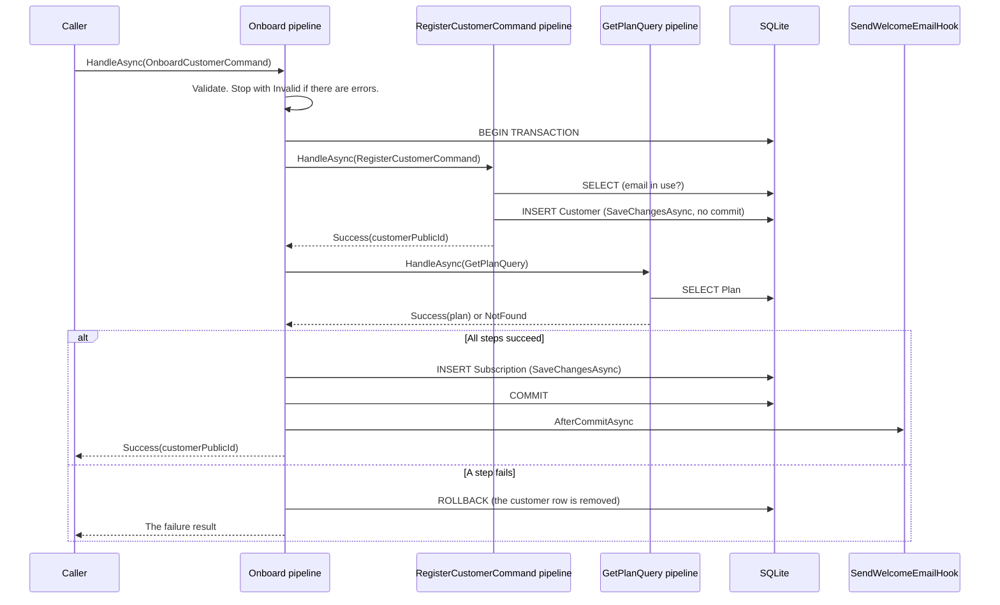

# Examples

The example project is a customer onboarding workflow that uses DannyGoodacre.Cqrs with EF Core and an in-memory SQLite database. Its test project sends each request through the full pipeline to that database. The other documents quote this project and name the source file of each quote.

| Project | Path |
| --- | --- |
| Console application | [`src/DannyGoodacre.Cqrs.Examples`](../../DannyGoodacre.Cqrs.Examples) |
| Pipeline tests | [`tests/DannyGoodacre.Cqrs.Examples.Tests`](../../../tests/DannyGoodacre.Cqrs.Examples.Tests) |

## Run the examples

From the repository root:

```shell
dotnet run --project src/DannyGoodacre.Cqrs.Examples
dotnet run --project tests/DannyGoodacre.Cqrs.Examples.Tests
```

The console application prints one line for each result (the identifiers change on every run):

```text
Registered customer f45171e2-626a-424b-b28f-c24540a13274.
Onboarded customer fbca811f-f67b-4ffc-9d6f-d0c18231a599 on plan PREMIUM.
Conflict: A customer with this email address already exists.
Plan 'GOLD' does not exist. No data was saved.
The request is not valid:
Name:
  - Name is required.
Email:
  - Email format is invalid.
PlanCode:
  - Plan code is required.
Customer f45171e2-626a-424b-b28f-c24540a13274 is on plan (none).
Customer fbca811f-f67b-4ffc-9d6f-d0c18231a599 is on plan PREMIUM.
Customer 57665600-a672-4485-847f-7e9c87fddc5c does not exist.
```

The pipeline logs are interleaved with these lines. For example, the conflict produces:

```text
info: DannyGoodacre.Cqrs.Examples.Onboarding.OnboardCustomerCommand[1001] 'OnboardCustomerCommand' started
info: DannyGoodacre.Cqrs.Examples.Customers.RegisterCustomerCommand[1001] 'RegisterCustomerCommand' started
warn: DannyGoodacre.Cqrs.Examples.Customers.RegisterCustomerCommand[1004] 'RegisterCustomerCommand' failed: Conflict { Message = A customer with this email address already exists. }
warn: DannyGoodacre.Cqrs.Examples.Onboarding.OnboardCustomerCommand[1004] 'OnboardCustomerCommand' failed: Conflict { Message = A customer with this email address already exists. }
```

## Domain

| Entity | Description |
| --- | --- |
| `Customer` | A registered customer with a unique email address. |
| `Plan` | A subscription plan, keyed by its code. The database is seeded with `BASIC` and `PREMIUM`. |
| `Subscription` | Links one customer to one plan. |

## Requests

| Request | Marker | Result | Shows |
| --- | --- | --- | --- |
| `RegisterCustomerCommand` | `IStateCommand` | `IResult<Guid>` | Automatic save, a validator, and a `Conflict` result. |
| `GetCustomerQuery` | `IQuery<CustomerDetails>` | `IResult<CustomerDetails>` | A query and a `NotFound` result. |
| `GetPlanQuery` | `IQuery<PlanDetails>` | `IResult<PlanDetails>` | A query called by a transacted command. |
| `OnboardCustomerCommand` | `ITransactedStateCommand` | `IResult<Guid>` | One transaction around a child command and a child query, a rollback, `MapFailure`, and a post-commit hook. |

## Onboarding workflow

`OnboardCustomerCommand` registers a customer and subscribes them to a plan in one transaction. After the commit, a post-commit hook sends a welcome email.



[COMMANDS-AND-QUERIES.md](COMMANDS-AND-QUERIES.md#itransactedstatecommand) explains each step.

## Scenarios in Program.cs

| Scenario | Result | Database after the request |
| --- | --- | --- |
| Register `ann@example.com` | `Success<Guid>` | One new customer. |
| Onboard `jane@example.com` on `PREMIUM` | `Success<Guid>` | One new customer and one subscription. The welcome email is sent. |
| Onboard `JANE@example.com` on `BASIC` | `Conflict<Guid>` from the child command | Unchanged. |
| Onboard `john@example.com` on `GOLD` | `NotFound<Guid>` | Unchanged. The rollback removes the customer row that step 1 wrote. |
| Onboard with empty fields | `Invalid<Guid>` | Unchanged. No SQL command runs. |
| Get Ann and Jane | `Success<CustomerDetails>` | Not applicable. |
| Get an unknown customer | `NotFound<CustomerDetails>` | Not applicable. |

## Files

| File | Contents |
| --- | --- |
| [`Program.cs`](../../DannyGoodacre.Cqrs.Examples/Program.cs) | Service configuration, the scenarios, and result handling, in one scope. |
| [`ExamplesServiceCollectionExtensions.cs`](../../DannyGoodacre.Cqrs.Examples/ExamplesServiceCollectionExtensions.cs) | Registration with `AddCqrsHandlers` and `AddEntityFrameworkUnits`. |
| [`Persistence/Entities.cs`](../../DannyGoodacre.Cqrs.Examples/Persistence/Entities.cs) | `Customer`, `Plan`, and `Subscription`. |
| [`Persistence/ExamplesDbContext.cs`](../../DannyGoodacre.Cqrs.Examples/Persistence/ExamplesDbContext.cs) | The EF Core model and the plan seed data. |
| [`Persistence/Repositories.cs`](../../DannyGoodacre.Cqrs.Examples/Persistence/Repositories.cs) | Data access for the handlers. |
| [`Customers/RegisterCustomerCommand.cs`](../../DannyGoodacre.Cqrs.Examples/Customers/RegisterCustomerCommand.cs) | The state command, its validator, and its handler. |
| [`Customers/GetCustomerQuery.cs`](../../DannyGoodacre.Cqrs.Examples/Customers/GetCustomerQuery.cs) | The customer query, its validator, and its handler. |
| [`Plans/GetPlanQuery.cs`](../../DannyGoodacre.Cqrs.Examples/Plans/GetPlanQuery.cs) | The plan query, its validator, and its handler. |
| [`Onboarding/OnboardCustomerCommand.cs`](../../DannyGoodacre.Cqrs.Examples/Onboarding/OnboardCustomerCommand.cs) | The transacted command, its validator, its handler, and its post-commit hook. |
| [`Notifications/EmailSender.cs`](../../DannyGoodacre.Cqrs.Examples/Notifications/EmailSender.cs) | `IEmailSender` and a stub that writes a log entry. |
| [`Infrastructure/ExamplesTestHost.cs`](../../../tests/DannyGoodacre.Cqrs.Examples.Tests/Infrastructure/ExamplesTestHost.cs) | Test host: the application with a private SQLite database per test. |
| [`Infrastructure/DatabaseActivity.cs`](../../../tests/DannyGoodacre.Cqrs.Examples.Tests/Infrastructure/DatabaseActivity.cs) | Test interceptor that records SQL commands and transactions. |
| [`RegisterCustomerPipelineTests.cs`](../../../tests/DannyGoodacre.Cqrs.Examples.Tests/RegisterCustomerPipelineTests.cs) | State command tests. |
| [`GetCustomerPipelineTests.cs`](../../../tests/DannyGoodacre.Cqrs.Examples.Tests/GetCustomerPipelineTests.cs) | Query tests. |
| [`OnboardCustomerPipelineTests.cs`](../../../tests/DannyGoodacre.Cqrs.Examples.Tests/OnboardCustomerPipelineTests.cs) | Transacted command tests: commit, rollback, hook timing, and validation. |

[TESTING.md](TESTING.md) describes the testing approach these tests use.
